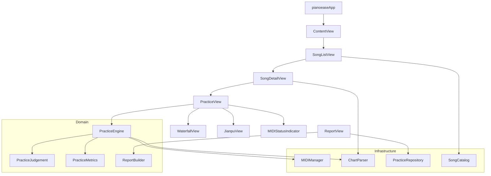

# 轻琴 (PianoEase) iPad App — 技术设计文档

> **版本**：v1.0
> **日期**：2026-07-13
> **状态**：已确认
> **阶段**：Phase 1.5 — iPad 原生练琴版
> **关联**：doc/01_product_requirements.md

---

## 一、技术选型

| 层 | 选型 | 理由 |
|---|---|---|
| UI 框架 | **SwiftUI** | iPad 原生，声明式 UI，Preview 快速迭代 |
| MIDI 接入 | **CoreMIDI** | iOS 原生 MIDI 框架，支持 USB + 蓝牙 |
| 瀑布流渲染 | **SpriteKit** | Apple 原生 2D 游戏引擎，60fps，替代 Web 版 Canvas |
| 简谱渲染 | **SwiftUI Canvas** | 自绘 2D 图形，灵活度高 |
| 本地存储 | **SwiftData** | Swift 原生 ORM，替代 Web 版 Drizzle + PostgreSQL |
| 状态管理 | **@Observable** | iOS 17+ 原生响应式，替代 Web 版 Zustand |
| 资源管理 | **Bundle Resources** | 曲谱 JSON 打包在 App 内 |

---

## 二、架构设计

### 2.1 分层架构

```
┌─────────────────────────────────────────┐
│           UI Layer (SwiftUI)            │  ← 视图 + 用户交互
├─────────────────────────────────────────┤
│          Domain Layer (Engine)          │  ← 业务逻辑 + 练习引擎
├─────────────────────────────────────────┤
│      Infrastructure Layer (Services)    │  ← MIDI/存储/数据解析
└─────────────────────────────────────────┘
```

**依赖规则**：
- UI → Domain → Infrastructure（单向依赖）
- Infrastructure 不依赖 UI 和 Domain
- Domain 通过协议与 Infrastructure 解耦

### 2.2 模块依赖图



---

## 三、数据模型

### 3.1 Chart JSON 格式（复用 Web 版）

直接复用 Web 版 `content/songs/` 下的 `chart.v0.json` 文件，iOS 端解析为以下 Swift 结构：

```swift
// 对应 Web 版 lib/chart/types.ts

struct SongChart: Codable {
    let songId: String
    let title: String
    let bpm: Int
    let ppq: Int                    // Pulses Per Quarter note
    let timeSignature: [Int]        // [numerator, denominator]
    let keySignature: String
    let variants: [ChartVariant]
}

struct ChartVariant: Codable {
    let id: ChartVariantId          // original/lv1/lv2/lv3
    let label: String
    let measures: [Measure]
    let noteEvents: [NoteEvent]
    let chordSegments: [ChordSegment]
}

struct NoteEvent: Codable {
    let id: String
    let hand: Hand                  // left/right
    let midi: Int                   // MIDI note number (0-127)
    let pitchName: String
    let startTick: Int
    let durationTick: Int
    let measureIndex: Int
    let beatInMeasure: Double
    let required: Bool
    let optional: Bool
    let chordSymbol: String?
}
```

### 3.2 本地持久化模型（SwiftData）

```swift
// 对应 Web 版 db/schema.ts practice_sessions 表

@Model class PracticeSessionModel {
    var songId: String
    var variant: String             // ChartVariantId.rawValue
    var mode: String                // PracticeMode.rawValue
    var score: Int
    var hitCount: Int
    var missCount: Int
    var wrongCount: Int
    var requiredNoteCount: Int
    var rightAccuracyPct: Int
    var leftAccuracyPct: Int
    var completionPct: Int
    var startedAt: Date
    var endedAt: Date?
    
    @Relationship(deleteRule: .cascade)
    var measureStats: [MeasureStatModel]
}

@Model class MeasureStatModel {
    var measureIndex: Int
    var hand: String                // Hand.rawValue
    var hitCount: Int
    var missCount: Int
    var avgTimingOffsetMs: Int?
}
```

### 3.3 二期 API 同步预留

```swift
// 协议抽象，一期用 Local 实现，二期增加 Remote 实现
protocol PracticeRepository {
    func savePracticeSession(_ session: PracticeSessionRecord) async throws
    func fetchSessions(forSongId: String) async throws -> [PracticeSessionRecord]
    func fetchRecentSessions(days: Int) async throws -> [PracticeSessionRecord]
}

// Phase 1
class LocalPracticeRepository: PracticeRepository { ... }

// Phase 2 (待实现)
class RemotePracticeRepository: PracticeRepository {
    // 调用 Web 版 Next.js REST API
    // POST /api/practice-sessions
    // GET  /api/practice-sessions?songId=xxx
}
```

---

## 四、核心引擎设计

### 4.1 练习引擎状态机

```
    ┌──────┐
    │ idle │ ←── reset()
    └──┬───┘
       │ start()
       ▼
    ┌──────────┐
    │ playing  │ ←── resume()
    └──┬───┬───┘
       │   │ pause()
       │   ▼
       │ ┌──────────┐
       │ │ paused   │
       │ └──────────┘
       │
       │ 所有音符完成
       ▼
    ┌──────────┐
    │ finished │ → 弹出报告
    └──────────┘
```

### 4.2 等待模式判定流程

```
MIDI NoteOn 事件到达
    │
    ├─ 1. 获取当前期望音符（pendingNotes[currentIndex]）
    │
    ├─ 2. 比较 MIDI note number
    │     ├─ 匹配 → 计算 timing offset
    │     │         ├─ ≤50ms  → Perfect (+100分, combo++)
    │     │         ├─ ≤150ms → Good (+50分, combo++)
    │     │         └─ >150ms → Miss (0分, combo=0)
    │     │
    │     │     → 推进到下一个音符
    │     │
    │     └─ 不匹配 → Wrong (combo=0, wrongCount++)
    │                → 显示红色反馈
    │
    └─ 3. 更新 PracticeMetrics
          · score, combo, maxCombo
          · hitCount, missCount, wrongCount
          · rightAccuracyPct, leftAccuracyPct
          · measureStats
```

### 4.3 瀑布流渲染（SpriteKit）

**核心组件**：
- `WaterfallScene: SKScene` — 管理渲染循环
- 音符方块：`SKSpriteNode`，按 hand 着色（左蓝右绿）
- 判定线：固定位置的水平线
- 虚拟琴键：底部显示区

**渲染逻辑（等待模式）**：
1. 预加载当前及后续 N 个音符的 SKNode
2. 音符从上往下滑动
3. 当前音符到达判定线后停止移动
4. 收到正确 MIDI 输入 → 播放命中动画 → 下一个音符开始移动
5. 已通过的音符向下移出屏幕后回收

**性能目标**：
- 60fps 稳定渲染
- 同屏音符数 ≤ 50 个（足够覆盖可视范围）
- 使用 SKNode 对象池避免频繁创建/销毁

### 4.4 简谱渲染（SwiftUI Canvas）

**渲染内容**：
- 数字音符（1-7 对应 do-si）
- 升降号（♯ ♭）
- 八度标记（数字上/下方的点）
- 时值标记（下划线表示八分/十六分音符）
- 小节线
- 和弦符号（显示在上方）
- 左右手分行显示

**MIDI → 简谱映射**：
```
MIDI Note → pitch class (0-11) → 简谱数字 (1-7)
                                → 升降号标记
MIDI Note → octave → 八度点位置（上方/下方）
```

---

## 五、文件结构

```
pianoease/
├── pianoeaseApp.swift              # App 入口 + 依赖注入
├── ContentView.swift               # NavigationStack 根容器
│
├── Models/                         # 数据模型（值类型）
│   ├── Song.swift                  # Song, SongLevel, SongManifest
│   └── ChartModels.swift           # SongChart, ChartVariant, NoteEvent, ...
│
├── Services/                       # 基础服务层
│   ├── SongCatalog.swift           # Bundle 曲库加载
│   ├── ChartParser.swift           # chart JSON 解析 + 校验
│   ├── MIDIManager.swift           # CoreMIDI 封装
│   └── MIDIEvent.swift             # MIDI 事件/状态类型
│
├── Engine/                         # 业务引擎层
│   ├── PracticeJudgement.swift     # 判定规则 (Perfect/Good/Miss)
│   ├── PracticeEngine.swift        # 练习状态机 + MIDI-chart 对齐
│   ├── PracticeMetrics.swift       # 练习指标采集
│   └── ReportBuilder.swift         # 报告生成
│
├── Views/                          # UI 视图层
│   ├── SongListView.swift          # 曲库首页
│   ├── SongDetailView.swift        # 曲目详情/准备页
│   ├── Sheet/                      # 简谱相关
│   │   ├── JianpuView.swift        # 简谱渲染主视图
│   │   └── JianpuRenderer.swift    # 渲染辅助计算
│   ├── Practice/                   # 练习相关
│   │   ├── PracticeView.swift      # 练习主页面
│   │   ├── WaterfallView.swift     # SpriteKit 瀑布流封装
│   │   ├── WaterfallScene.swift    # SKScene 渲染逻辑
│   │   └── PracticeToolbar.swift   # 练习工具栏
│   ├── Report/                     # 报告相关
│   │   ├── PracticeReportView.swift    # 单次练习报告
│   │   ├── MeasureHeatmapView.swift    # 错音热力图
│   │   └── PracticeHistoryView.swift   # 历史记录列表
│   └── MIDI/                       # MIDI 连接 UI
│       ├── MIDIStatusIndicator.swift   # 状态指示灯
│       └── MIDIConnectionSheet.swift   # 设备管理弹窗
│
├── Store/                          # 数据存储层
│   ├── PracticeRepository.swift    # 存储协议 + Local 实现
│   ├── PracticeSessionModel.swift  # SwiftData 会话模型
│   └── MeasureStatModel.swift      # SwiftData 小节统计模型
│
├── Theme/                          # 设计系统
│   └── AppTheme.swift              # 颜色/字体/间距/样式
│
└── Resources/songs/                # 静态曲谱资源
    ├── manifest.json
    ├── friendship-years/chart.v0.json
    ├── city-in-the-sky/chart.v0.json
    └── river-flows/chart.v0.json
```

---

## 六、实施计划

### 迭代 1：静态曲库 + 简谱浏览（~1 周）

| 任务 | 涉及文件 | 说明 |
|---|---|---|
| 数据模型 | Models/* | Song, ChartModels |
| 数据解析 | Services/SongCatalog, ChartParser | Bundle 加载 + JSON 解析 |
| 设计系统 | Theme/AppTheme | 色板 + 样式 |
| 曲库页面 | Views/SongListView | 卡片网格 + 搜索 |
| 详情页面 | Views/SongDetailView | 信息 + 难度选择 |
| 简谱组件 | Views/Sheet/* | Canvas 自绘简谱 |
| 资源文件 | Resources/songs/* | 从 Web 项目复制 |

### 迭代 2：MIDI + 瀑布流练习（~2 周）

| 任务 | 涉及文件 | 说明 |
|---|---|---|
| MIDI 管理 | Services/MIDIManager, MIDIEvent | CoreMIDI 封装 |
| MIDI UI | Views/MIDI/* | 状态灯 + 设备管理 |
| 判定引擎 | Engine/PracticeJudgement | 移植 Web 版规则 |
| 练习引擎 | Engine/PracticeEngine, PracticeMetrics | 状态机 + 指标 |
| 瀑布流 | Views/Practice/Waterfall* | SpriteKit 渲染 |
| 练习页面 | Views/Practice/PracticeView, Toolbar | 组合页面 |

### 迭代 3：报告 + 存储（~1 周）

| 任务 | 涉及文件 | 说明 |
|---|---|---|
| 报告生成 | Engine/ReportBuilder | 移植 Web 版逻辑 |
| 报告页面 | Views/Report/* | 报告 + 热力图 + 历史 |
| 本地存储 | Store/* | SwiftData 模型 + Repository |
| App 入口 | pianoeaseApp.swift | 依赖注入 + ModelContainer |
| UI 打磨 | 全部 Views | 动画 + 过渡 + iPad 适配 |

---

## 七、验证计划

### 7.1 单元测试

| 模块 | 测试内容 |
|---|---|
| PracticeJudgement | 各 timing offset 值的判定结果 |
| PracticeMetrics | score/combo/accuracy 计算 |
| ReportBuilder | heatValues/rhythmLabel 生成 |
| ChartParser | 3 首歌的 chart JSON 解析正确性 |
| SongCatalog | manifest.json 解析和查询 |

### 7.2 集成验证

| 场景 | 验证方法 |
|---|---|
| MIDI 连接 | 真机 + USB MIDI 键盘 |
| 瀑布流性能 | Instruments 检测帧率 |
| 练习全流程 | 选曲 → 练习 → 报告 E2E |
| 数据持久化 | 杀掉 App 后重启查看历史记录 |

### 7.3 Web 版一致性验证

| 项目 | 验证方法 |
|---|---|
| 判定规则 | 同一 timing offset 在 Web 和 iOS 产出相同 judge |
| 评分计算 | 同一练习序列在 Web 和 iOS 产出相同 score |
| 报告数据 | 同一 measureStats 在 Web 和 iOS 产出相同 report |
